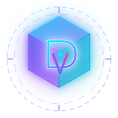

<div align="center">

<!-- Animated / Interactive Logo Banner -->


# ⚡ DhruvBuilds — 3D Cyber Portfolio
### *Creative Technologist, 3D WebGL Architect & Software Engineer*

[](https://dhruvbuilds.epizy.com)
[](https://threejs.org/)
[](https://get.webgl.org/)
[](https://app.infinityfree.net/)
[](LICENSE)

<br/>

<p align="center">
  <b>A futuristic, high-performance 3D spatial portfolio engineered with Three.js, WebGL shaders, a synthesized Web Audio FX engine, and an interactive cyber CLI terminal.</b>
  <br/>
  <i>100% static client-side codebase • Zero Node server dependency • Pre-configured for InfinityFree Apache hosting.</i>
</p>

<!-- Social Connect Badges -->
<p align="center">
  <a href="https://github.com/dhruvbuilds"></a>
  <a href="https://linkedin.com/in/dhruvbuilds"></a>
  <a href="https://youtube.com/@dhruvbuilds"></a>
  <a href="https://instagram.com/dhruvbuilds"></a>
  <a href="mailto:dhruvbuilds@gmail.com"></a>
</p>

---

</div>

## 📑 Interactive Table of Contents

- [✨ Core Highlights](#-core-highlights)
- [🌌 3D WebGL Spatial Core](#-3d-webgl-spatial-core)
- [🎛️ Interactive Cyber Terminal (CLI)](#️-interactive-cyber-terminal-cli)
- [🔊 Web Audio Synthesizer (SFX)](#-web-audio-synthesizer-sfx)
- [🎨 Dynamic Themes & 3D Tilt Physics](#-dynamic-themes--3d-tilt-physics)
- [📄 Resume Download & Interactive Modal](#-resume-download--interactive-modal)
- [📐 System Architecture & Diagrams](#-system-architecture--diagrams)
- [📂 Project Directory Tree](#-project-directory-tree)
- [⚡ Quick Start & Local Testing](#-quick-start--local-testing)
- [🚀 InfinityFree Deployment Guide](#-infinityfree-deployment-guide)
- [⚙️ Personalization & Config](#️-personalization--config)

---

## ✨ Core Highlights

<table>
  <tr>
    <td width="50%">
      <h3>🌌 3D Interactive WebGL Core</h3>
      <ul>
        <li><b>Three.js r128 Engine:</b> Real-time lighting, materials, and dynamic camera projection.</li>
        <li><b>4 Switchable Geometries:</b> Quantum Core, Torus Portal, Hypercube, Neural Stars.</li>
        <li><b>Physical Interactivity:</b> Mouse parallax, full 3D drag-to-spin, touch swipe, and click shockwaves.</li>
        <li><b>100% Canvas Fallback:</b> Native HTML5 3D projection if WebGL or CDN is unavailable.</li>
      </ul>
    </td>
    <td width="50%">
      <h3>🎛️ Cyber CLI Terminal</h3>
      <ul>
        <li><b>Functional In-Browser Shell:</b> Type commands like <code>about</code>, <code>skills</code>, <code>projects</code>, <code>resume</code>, <code>matrix</code>.</li>
        <li><b>Matrix Rain Easter Egg:</b> Falling green cyber matrix rain animation.</li>
        <li><b>Mobile Quick Chips:</b> 1-click execution chips for touch screens.</li>
      </ul>
    </td>
  </tr>
  <tr>
    <td width="50%">
      <h3>🔊 Web Audio Synthesizer</h3>
      <ul>
        <li><b>Zero External Audio Files:</b> Pure mathematical waveforms (sine, triangle, sawtooth).</li>
        <li><b>Futuristic Sound FX:</b> Hover chirps, click blips, warp hums, and success chimes.</li>
        <li><b>Opt-In & Persisted:</b> Sound toggle with animated soundwave indicator and <code>localStorage</code> sync.</li>
      </ul>
    </td>
    <td width="50%">
      <h3>📄 Resume & Branding</h3>
      <ul>
        <li><b>1-Click Resume Download:</b> Direct download of <code>Dhruv_Resume.pdf</code>.</li>
        <li><b>In-Browser CV Viewer:</b> Modal preview with printable layout (<code>window.print()</code>).</li>
        <li><b>Custom 3D Vector Logo:</b> Faceted isometric 'DV' crystal emblem and favicon.</li>
        <li><b>Zero Freelance Tone:</b> Structured exclusively as an elite engineering portfolio.</li>
      </ul>
    </td>
  </tr>
</table>

---

## 🌌 3D WebGL Spatial Core

<details open>
<summary><b>🔍 Click to expand 3D Model Specifications & Controls</b></summary>

<br/>

| Mode | Geometry Breakdown | Visual Effect | Interaction |
| :--- | :--- | :--- | :--- |
| **🔷 Quantum Core** | Central Octahedron + Outer Icosahedron + Dual Torus Gimbal Rings + 6 Orbiting Satellites | Pulsating energy core with multi-axis counter-rotating rings | Responds to cursor position; clicks trigger explosive particle blast |
| **🌀 Torus Portal** | TorusKnotGeometry (p:2, q:3) with 140 tubular segments + Wireframe outer tube | Chromatic glowing cyber portal twisting infinitely | Continuous angular momentum with smooth mouse deceleration |
| **🧊 Hypercube** | 26 3D Box Geometries arranged in a 3x3x3 hollow floating matrix | Sine-wave oscillating floating data cubes | Dynamic vertical levitation based on spatial coordinate offsets |
| **✨ Neural Stars** | 350+ spherical point cloud particles + Icosahedron bounding wireframe | Cosmic constellation with floating neural dust | Additive blending with rippling spatial oscillations |

#### Interactive Controls:
* **Rotate in 3D:** Click and drag anywhere on the 3D canvas (or touch & drag on mobile).
* **Shockwave Pulse:** Click directly on the 3D hologram to fire an energy pulse.
* **Wireframe Toggle:** Click `Toggle Wireframe [W]` on the HUD bar.
* **Model Switcher:** Click any mode chip (`Quantum Core`, `Torus Portal`, `Hypercube`, `Neural Stars`).

</details>

---

## 🎛️ Interactive Cyber Terminal (CLI)

<details open>
<summary><b>💻 Click to view all Terminal Commands</b></summary>

<br/>

The terminal is embedded directly in the `#terminal` section of the website. Test these commands live in the browser:

```bash
dhruv@quantum-core:~$ help
```

| Command | Action | Output / Behavior |
| :--- | :--- | :--- |
| `help` | Show command directory | Displays formatted directory of all terminal capabilities |
| `about` | Developer summary | Outputs background, engineering philosophy, and mission |
| `skills` | Technical stack | Prints categorized arsenal (3D, Frontend, Backend, AI) |
| `projects` | Featured builds | Lists top builds with direct navigation links |
| `resume` | Resume workflow | Opens in-browser CV modal and prepares PDF download |
| `socials` | Connect channels | Outputs direct links to GitHub, LinkedIn, YouTube, Instagram, Email |
| `matrix` | Cyber stream | Spawns falling green digital rain canvas across the entire viewport |
| `theme` | Cycle theme | Cycles through Cyber Neon, Matrix Rain, Solar Flare, and Deep Cosmos |
| `clear` | Wipe screen | Clears terminal screen buffer |
| `sudo` | Easter egg | Displays administrator clearance response |

</details>

---

## 🔊 Web Audio Synthesizer (SFX)

<details>
<summary><b>🎵 Click to view Audio Synthesis Architecture</b></summary>

<br/>

Rather than bloating the site with heavy `.mp3` or `.wav` files that cause slow network requests on free hosts, all sound effects are synthesized on-the-fly using the native browser **Web Audio API**:

```javascript
// Example: Synthesizing a futuristic Warp Hum on the fly
const osc = audioCtx.createOscillator();
const gain = audioCtx.createGain();
osc.type = 'sawtooth';
osc.frequency.setValueAtTime(180, audioCtx.currentTime);
osc.frequency.exponentialRampToValueAtTime(900, audioCtx.currentTime + 0.2);
gain.gain.setValueAtTime(0.03, audioCtx.currentTime);
gain.gain.linearRampToValueAtTime(0.001, audioCtx.currentTime + 0.2);
```

* **Hover SFX:** 420Hz &rarr; 780Hz sine chirp (40ms)
* **Click SFX:** 580Hz &rarr; 1200Hz triangle blip (60ms)
* **Warp SFX:** 180Hz &rarr; 900Hz sawtooth sweep (200ms)
* **Success Chime:** 4-tone harmonic arpeggio (C5 &rarr; E5 &rarr; G5 &rarr; C6)

</details>

---

## 🎨 Dynamic Themes & 3D Tilt Physics

<details>
<summary><b>🎨 Click to inspect Color Palettes & CSS 3D Tilt Mechanics</b></summary>

<br/>

### Color Schemes:
1. **💜 Cyber Neon (Default):** Cyan (`#00f2fe`) & Electric Violet (`#8b5cf6`)
2. **💚 Matrix Rain:** Matrix Emerald (`#00ff88`) & Deep Mint (`#10b981`)
3. **🧡 Solar Flare:** Solar Gold (`#f59e0b`) & Sunset Coral (`#ef4444`)
4. **💙 Deep Cosmos:** Ice Blue (`#38bdf8`) & Sapphire Cobalt (`#3b82f6`)

### Real-Time CSS 3D Card Physics:
Every card computes its center offset relative to the mouse cursor on mousemove:
$$\text{rotateX} = \left(\frac{y - y_{\text{center}}}{y_{\text{center}}}\right) \times -10^\circ$$
$$\text{rotateY} = \left(\frac{x - x_{\text{center}}}{x_{\text{center}}}\right) \times 10^\circ$$
Along with dynamic radial glare reflections and `transform: translateZ(25px)` on inner card content for real holographic depth.

</details>

---

## 📄 Resume Download & Interactive Modal

<details open>
<summary><b>📋 Click to inspect Resume Options & Verification</b></summary>

<br/>

* **Direct PDF Download:** Configured with HTML5 `download="Dhruv_Resume.pdf"` attribute. Clicking downloads the pre-generated, verified PDF directly from `assets/Dhruv_Resume.pdf`.
* **In-Browser Modal:** Accessible via the "View CV" button in the Hero, About, and Terminal sections.
* **Print-to-PDF Ready:** Features CSS `@media print` rules; clicking "Print / Save as PDF" formats the document cleanly for physical printing or saving as a vector PDF.
* **Toast Feedback:** Instant visual feedback toast appears confirming file download.

</details>

---

## 📐 System Architecture & Diagrams

```mermaid
flowchart TD
    subgraph Client Browser
        A[index.html Entrypoint] --> B[Three.js Scene Engine]
        A --> C[SoundFX Synthesizer]
        A --> D[Cyber CLI Terminal]
        A --> E[3D Card Tilt Physics]
        A --> F[Modal & Toast Engine]

        subgraph 3D Rendering Pipeline
            B --> G{WebGL 2.0 Supported?}
            G -->|Yes| H[Three.js Canvas: 4 Geometries + Shaders]
            G -->|No / Blocked| I[Pure HTML5 Canvas 3D Vector Projection]
        end

        subgraph Audio Pipeline
            C --> J[Web Audio API Context]
            J --> K[OscillatorNode & GainNode]
            K --> L[Synthesized SFX Blips]
        end
    end

    subgraph Static Web Host InfinityFree
        M[htdocs Directory] --> N[.htaccess: GZIP, Caching, MIME, CORS]
        M --> O[index.html + css/ + js/ + assets/]
    end

    Client Browser <-->|Fast Static Delivery| Static Web Host InfinityFree
```

---

## 📂 Project Directory Tree

```bash
dhruvbuilds/
├── .htaccess                  # Apache server configuration (GZIP, Caching, Security)
├── DEPLOYMENT_GUIDE.md        # Step-by-step 2-minute InfinityFree deployment guide
├── README.md                  # Interactive Documentation & Architecture Guide
├── index.html                 # Main website entrypoint with inline SVGs & semantic HTML5
├── assets/                    # Static media & downloadable assets
│   ├── Dhruv_Resume.pdf       # Verified professional resume PDF
│   ├── favicon.svg            # 3D Vector browser favicon
│   ├── logo.svg               # High-res 3D faceted cyber vector logo
│   └── icons/
│       └── logo.svg           # Component icon logo
├── css/
│   └── style.css              # Glassmorphism, 3D perspective, cyber theme variables & responsive grid
└── js/
    ├── three-scene.js         # Three.js 3D WebGL engine & Canvas fallback
    └── script.js              # Web Audio synth, cyber CLI, card tilt, modals, toast system
```

---

## ⚡ Quick Start & Local Testing

<details open>
<summary><b>▶️ Click to expand Local Development Options</b></summary>

<br/>

Since this project uses pure HTML5, CSS3, and JavaScript, **no `npm install` or compilation step is needed**!

### Option 1: Using Python (Built-in)
```bash
# In the project directory:
python -m http.server 8000
```
Then open `http://localhost:8000` in your browser.

### Option 2: Using Node.js
```bash
npx serve .
```

### Option 3: Using VS Code Live Server
Right-click `index.html` and click **"Open with Live Server"**.

</details>

---

## 🚀 InfinityFree Deployment Guide

<details open>
<summary><b>🌐 Click to expand Step-by-Step InfinityFree Instructions</b></summary>

<br/>

### Method A: Online File Manager (Recommended — 2 Minutes)
1. Log in to your **[InfinityFree Dashboard](https://app.infinityfree.net/)**.
2. Select your account (e.g. `dhruvbuilds.infinityfreeapp.com` or `dhruvbuilds.epizy.com`).
3. Click **File Manager**.
4. Open the **`htdocs`** folder.
5. If there is a default file like `index2.html`, delete it.
6. Upload the following items into `htdocs`:
   - `index.html`
   - `.htaccess`
   - `css/`
   - `js/`
   - `assets/`
7. Navigate to your domain — your 3D portfolio is immediately live!

### Method B: FTP via FileZilla
1. Get your FTP credentials from your InfinityFree Account Details (Host: `ftpupload.net`, Username, Password, Port: `21`).
2. Connect using **FileZilla**.
3. Open the remote **`htdocs`** directory.
4. Drag and drop all files from this repository directly into `htdocs`.

</details>

---

## ⚙️ Personalization & Config

<details>
<summary><b>🔧 Click to expand Configuration Parameters</b></summary>

<br/>

You can update your personal contact info, links, and identity anytime by editing `USER_CONFIG` at the top of [`js/script.js`](js/script.js):

```javascript
window.USER_CONFIG = {
  name: "Dhruv",
  brand: "DhruvBuilds",
  title: "Creative Technologist & 3D Web Architect",
  email: "dhruvbuilds@gmail.com",
  github: "https://github.com/dhruvbuilds",
  linkedin: "https://linkedin.com/in/dhruvbuilds",
  instagram: "https://instagram.com/dhruvbuilds",
  youtube: "https://youtube.com/@dhruvbuilds",
  resumePath: "./assets/Dhruv_Resume.pdf"
};
```

</details>

---

<div align="center">

### 🌟 Connect With Dhruv

[](https://github.com/dhruvbuilds)
[](https://linkedin.com/in/dhruvbuilds)
[](https://youtube.com/@dhruvbuilds)
[](https://instagram.com/dhruvbuilds)
[](mailto:dhruvbuilds@gmail.com)

<br/>

<sub>Engineered with precision by Dhruv • Built with Three.js, WebGL &amp; Modern Web Standards</sub>

</div>

